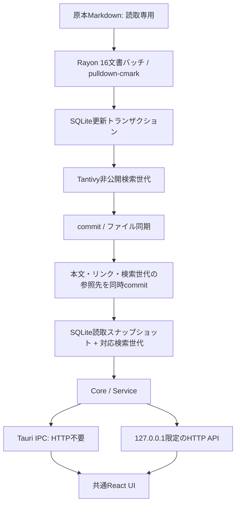

# 0.2.0 アーキテクチャ

## 保存単位と排他

`registry.sqlite`はプロジェクトID・名称・原本ルートを保持する。プロジェクトごとの`indexes/ID/metadata.sqlite`に原文・本文・ハッシュ・mtime・リンク・別名・見出しを保持し、`state_text.search_generation`が対応する検索世代を指す。

更新者は専用writerロックで直列化する。閲覧者と更新者はライフサイクル共有ロックを保持し、削除・旧世代回収は排他ロックを必要とする。閲覧操作はSQLite読取トランザクションを開始してから検索世代を取得する。更新中も旧本文と旧検索索引の組を読む。公開直前の失敗・子プロセス終了ではSQLiteがrollbackされ、未公開検索世代は次回に回収する。

Tantivyの変更不能なsegmentファイルは世代間でハードリンクを共有する。ファイルシステムが対応しなければコピーする。meta.json・管理情報・ロックなどの可変ファイルはコピーする。原本MDにハードリンクを作ることはない。旧世代は閲覧者がいない時のみ回収し、Windowsで使用中のファイルは次回へ延期する。

## 検索とリンク解決

文字位置を持つ1文字・2文字の専用トークナイザーを使用し、複数文字の語はbigramの位置付きフレーズで照合する。空白で区切った語はAND、タイトルと本文はOR。タイトルに重みを付ける。旧形式の検索索引は移行前の閲覧を維持し、再作成／scanで新形式へ更新する。

Readerは最大8世代、検索結果は各世代で最大32ページを保持する。公開世代が変わればキャッシュも分離される。結果キャッシュを含む反復検索と、未キャッシュの検索時間は性能報告で区別する。

初回作成・完全再作成ではsegmentを最適化する。通常の差分更新では大規模mergeを同期実行しない。長期運用でsegmentや削除済み領域が蓄積して容量・検索時間が増えた場合は「再作成」で最適化する。これにより日常の差分反映と、時間のかかる保守を分離する。

リンクは同じフォルダー、プロジェクト相対パス、一意なファイル名／別名の順に解決する。追加・削除では対象名を参照するsourceだけ再解決する。別名・見出しが変わる時は旧名・新名を含めて影響範囲を広げる。見出し欠如は`missing-heading`、同名候補は`ambiguous`として誤接続を避ける。安全な空の`<a id="...">`／`name`のみアンカーへ変換し、任意HTMLは表示時に除外する。

## UIと監視

Reactの通信層がWebのHTTPとDesktopのIPCを切り替える。Tauriは同梱main画面だけに操作を許可する。Desktopはプロジェクトごとにnotify workerを管理し、停止・プロジェクト削除でworkerを終了する。イベントを250msでまとめ、キューは4096件、60秒ごとにメタデータを照合する。監視はアプリ起動時に停止状態。画面の再取得は「表示を更新」で行う。

## ローカル利用の境界

DesktopはWebサーバーを起動しない。Web APIとViteは127.0.0.1固定。ネットワーク公開、外部更新配信、SSOはユーザー指示により対象外。画像／添付・Mermaidコードブロックの図化・横断検索・AI/MCPは将来の拡張で、現在のMarkdown本文・文書間リンク図とは別機能。
