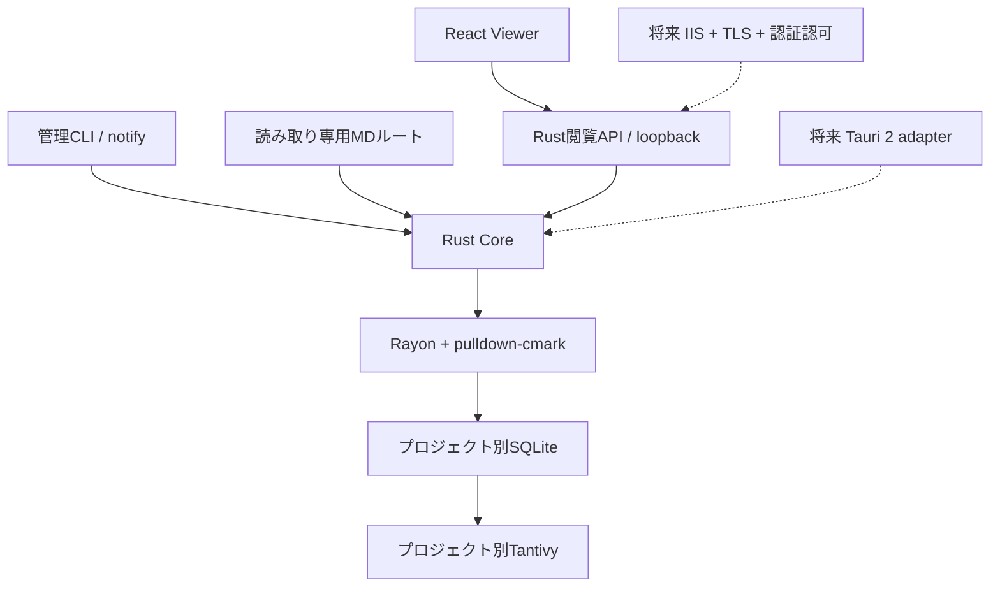

> 初期計画の履歴です。2026-11-01のユーザー指示によりネットワーク公開は対象外。現在の構成は[アーキテクチャ](ARCHITECTURE.ja.md)、実装状況は[0.2.0検証結果](RELEASE-0.2.0.ja.md)を参照してください。

# 詳細設計・実装計画（2026-10-31）

## 目的と完成条件

複数システムの仕様書を読み取り専用で横断的に管理する。最初の成果物は永続プロジェクト登録、差分スキャン、全文検索、WikiLinkと通常MDリンクの解析、Backlinks、文書閲覧の動く縦断実装。10万件対応は目標であり、実測と負荷試験の完了前には達成を主張しない。

## アーキテクチャ

CoreはUI・HTTPに依存しない。管理設定は共通registry SQLite、文書・リンクはプロジェクト別metadata.sqlite、検索はsearch/。プロジェクトIDはASCII小文字英数字・ハイフン・アンダースコア（Windows予約名を除外）に限定し、ルートとデータディレクトリの重なりを拒否する。シンボリックリンクを追跡しない。読み取りAPIは索引済みパスをDBから参照し、任意ファイルを開かない。

## データと更新整合性

文書主キーはプロジェクト内相対パス。パス、サイズ、ナノ秒mtime、BLAKE3、タイトル、抽出本文、原文を保存。リンクはsource/target文字列/解決先/statusを持ち、target索引で逆参照する。移動は削除＋追加。プロジェクト間のリンク解決は行わない。

通常スキャンは全ファイルのメタデータのみ調べ、変更候補のみ読み込み・並列解析する。ハッシュ一致なら解析を省く。サイズ・mtimeが両方変わらない書き換えは通常スキャンで検知しないため、verifyオプションで全ハッシュ再検証を可能にする。UTF-8不正・読み取り失敗・走査失敗は更新を中断し、既存索引を保持する。

SQLite更新は単一トランザクションでdirtyフラグと変更文書を確定。その後Tantivyにdelete/addしてcommit。正常終了時dirtyを解除する。途中で失敗した場合、次回scanでSQLiteの本文からTantivy全件を再構築し再実行可能にする。SQLiteとTantivyを跨ぐACIDは存在せず、クラッシュ直後の検索に一時的不整合があり得る。安定世代の原子的公開はM2で導入する。

M2前半では本文だけの変更なら該当文書の出リンクだけを再解決する。追加・削除時はリンク全体を再評価し、結果が変わった行だけを書き換える。パス・stemの辞書で候補探索を行い、相対パス一致、ルートパス一致、ユニークstemの順に解決。曖昧なstemはambiguous、未存在はmissing。`[[target|label]]`、`[[target#heading]]`、通常の相対`.md`リンクに対応。コード中は解析対象から除外。外部URLはグラフ対象外。frontmatter alias・見出しIDの存在検証はM2後半。

検索はUnicodeの1～2文字N-gramを使用し日本語・中国語・英語の基本的な部分一致を提供する。形態素解析や言語別ランキングとは異なる。単純AND検索を基本とし、高度な検索文法や英語語幹処理は別途評価する。

notifyは変更イベントを250msでまとめ、通常のファイル変更は対象パスのみ更新する。イベントキューは4,096件を上限とし、溢れた場合は全体照合する。フォルダ操作・rename・不明イベント・再走査要求・監視エラーも全体scanに戻す。取りこぼし対策に60秒ごとの全メタデータ走査を行う。イベント対象経路はmtimeが不変でもハッシュ照合する。ネットワーク共有はPollingフォールバックを将来追加する。

## API / UI

GET /api/projects、/api/search?project=&q=、/api/document?project=&path=、/api/backlinks?project=&path=、/api/links?project=を提供。結果件数は上限を設ける。登録・再索引はCLIのみ。画面はプロジェクト選択、検索、結果、Markdown閲覧、Backlinksとリンク診断。HTML原文を有効にせずスクリプト混入を避ける。

M2前半でGET /api/document-links?project=&path=&offset=0&limit=100を追加。limitは1～200、返却はitemsとnext_offset。ReactはこのAPIで文書の出リンクを追加取得する。旧/api/linksは互換用途で先頭5,000件の上限を維持する。安定索引内ではtarget/rowid順。更新中のページ横断スナップショットは未対応。

Sigma.js + Graphologyの局所グラフはM3。全体グラフは10万ノードを一括返却せずサブシステム集約、局所200～500ノード、深さ・辺数制限、サーバー側ページングを採用。TauriはHTTP実装をコピーせずCoreのコマンドアダプターと共有Reactを使用する。

## マイルストーンと受入試験

|工程|成果物|受入条件|
|---|---|---|
|M0 設計|日本語README、設計、CI定義|構成・性能目標・未完了範囲を明記|
|M1 動く基盤|Rust Core/CLI/閲覧API/React|登録→索引→検索→閲覧→Backlinks、再起動、削除・更新、原本不変テスト|
|M2 整合性・性能|安定世代公開、ジョブ、イベント局所更新、alias、ページング|途中停止復旧・読取失敗・1万/5万/10万件測定|
|M3 グラフ・Desktop|Sigma/Graphology、Tauri 2 Windows配布|局所グラフ、フォルダ選択、インストーラー動作|
|M4 チーム運用|IIS手順、SSO/ACL、監査、バックアップ|権限外検索防止、50～100同時閲覧、TLS、復旧訓練|
|M5 拡張|横断検索・AI・MCP|プロジェクト境界を保ったAPIと評価|

## 性能目標（未達成保証）

基準条件はWindows 11、8物理コア、32GB RAM、NVMe、平均8KiB UTF-8 MD、10万文書、平均10リンク。コールド/ウォーム、ウイルス対策の影響、総バイト、CPU・メモリ・索引容量を記録する。

|処理|目標|測定範囲|
|---|---|---|
|初回10万索引|5分以内（挑戦目標）|走査から両索引commitまで|
|全文検索|P95 ≤100ms|Core、ウォーム、50件上限|
|Backlinks|P95 ≤30ms|SQLite、上限500件|
|プロジェクト切替|100～300ms|Reader常駐後、再走査なし|
|単一MD差分|≤1秒|イベント受付から読取反映まで|
|局所グラフ|P95 ≤100ms|500ノード以内のAPI|
|チーム閲覧|50～100同時利用|検索・閲覧混合、エラー率とP95|

1万→5万→10万の順で合成データと実データを測定。日本語・中国語・英語、同名、深いディレクトリ、巨大ファイル、リンク密度を変える。合成試験だけでは実文書の検索精度を保証しない。

## 実装順序と確認手順

- [x] Coreの統合テストを先に作り、空実装で失敗を確認。
- [x] 永続登録、並列解析、SQLite、Tantivy、リンク解決を実装し`cargo test -p hub-core`を成功させる。
- [x] CLI、notify、閲覧APIを追加し実際のHTTPを確認。
- [x] React UI、プロジェクト切替、本文表示とBacklinksを実装しproduction build。
- [x] Windows/Linux CI、合成測定スクリプトを追加。
- [x] fmt/test/clippy/UI build、性能実測を記録。コミット・pushはGit履歴を参照。

## 技術一次資料

- https://docs.rs/tantivy/0.26.2/tantivy/
- https://docs.rs/tantivy/latest/tantivy/tokenizer/struct.NgramTokenizer.html
- https://pulldown-cmark.github.io/pulldown-cmark/specs/wikilinks.html
- https://rustsec.org/advisories/RUSTSEC-2026-0414.html （WikiLink修正版0.13.5以上を使用）
- https://docs.rs/notify/latest/notify/
- https://docs.rs/rusqlite/latest/rusqlite/
